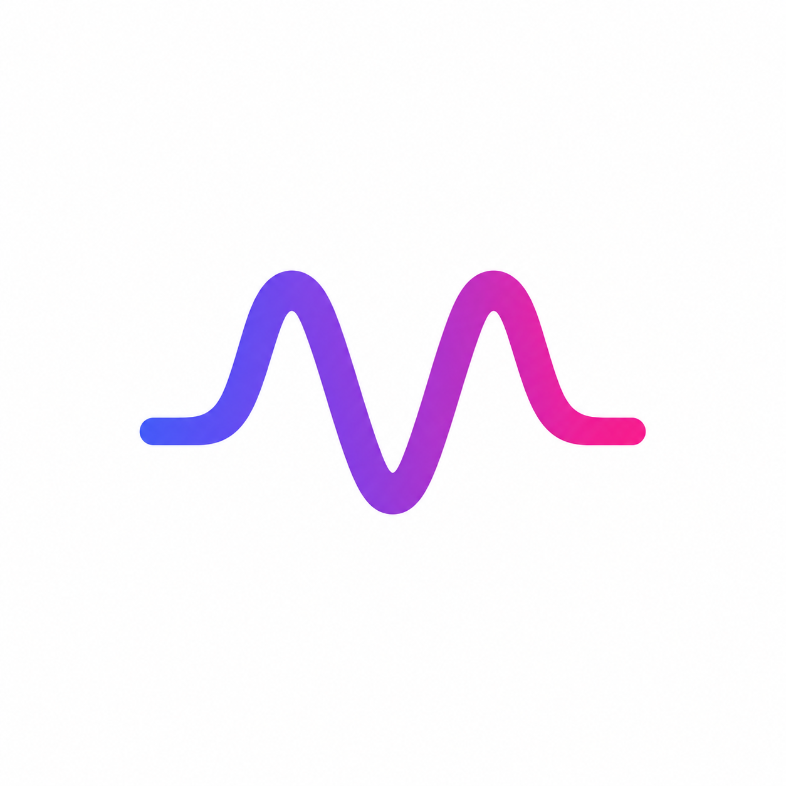
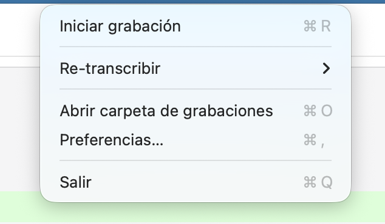
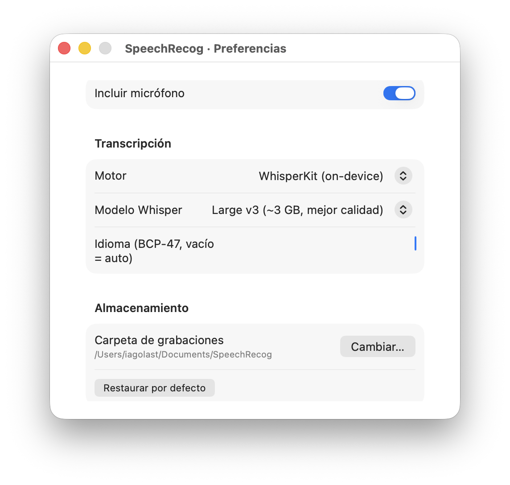

<p align="center">
  
</p>

<h1 align="center">SpeechRecog</h1>

<p align="center">
  <strong>Your calls, transcribed on your Mac.</strong><br/>
  Capture the audio. Stay focused on the conversation. Get the transcript afterwards.
</p>

<p align="center">
  macOS 15+ · Apple Silicon · Menu bar app · Local transcription
</p>

SpeechRecog captures the audio playing on your Mac, optionally adds your microphone, and turns the recording into a transcript with timestamps. It works independently of your calling app: **it never joins the meeting, adds a bot, or appears in the participant list.** Your call and audio playback continue as usual.

There is also an iPhone companion for voice notes, started from the Action Button. The Mac app is unchanged. See [iPhone](#iphone).

**Record first. Transcribe afterwards.** While you talk, SpeechRecog saves the audio locally. When you stop recording, it automatically starts asynchronous transcription and saves an `.srt` file next to the audio.

<p align="center">
  <a href="#installation">Install</a> ·
  <a href="#record-your-first-call">Get started</a> ·
  <a href="#transcription-engines">Choose an engine</a> ·
  <a href="#iphone">iPhone</a> ·
  <a href="#under-the-hood">Technical details</a>
</p>

## Built around your conversation

- **Independent of the meeting platform.** Capture calls in desktop apps or your browser, plus webinars, interviews, and other audio playing on your Mac. No meeting integration to configure.
- **Local audio, local models.** WhisperKit, Qwen, and MOSS transcribe on your Mac without uploading recordings to a transcription service. See [engine details](#transcription-engines) for the optional Apple Speech backend.
- **Both sides of the call.** Include your microphone to capture your own voice alongside the people you hear. Turn it off when you only want system audio.
- **Ready from the menu bar.** Start and stop recording, check transcription progress, and open your recordings. No Dock window or virtual audio driver needed.
- **Files you can keep and reuse.** Get an `.m4a` recording and an `.srt` transcript with timestamps. Revisit a recording later and transcribe it again with another model or language.

<p align="center">
  
  &nbsp;&nbsp;
  
</p>

## Installation

### Requirements

- An **Apple Silicon Mac** running **macOS 15 or later**.
- **Xcode with Swift 6.3 or later**, selected as the active developer tools. The standalone Command Line Tools are not sufficient for this build.
- The **Metal Toolchain**, used by the local MLX models:

  ```bash
  xcodebuild -downloadComponent MetalToolchain
  ```

- An internet connection to download build dependencies and models on first use. Allow several GB of storage for Qwen or MOSS models.

### Install with one command

The installer downloads the source, builds the app on your Mac, and installs it in `/Applications`:

```bash
curl -fsSL https://raw.githubusercontent.com/IagoLast/SpeechRecog/master/scripts/install.sh | bash
```

Open the app:

```bash
open /Applications/SpeechRecog.app
```

A waveform icon appears in the menu bar. The first build can take several minutes. You can [inspect the installer](scripts/install.sh) or [build from a local checkout](#build-from-source).

## Record your first call

The app's interface is currently in Spanish; the labels below match what you will see.

1. **Set up your recording.** Open **Preferencias… → General**. Leave **Incluir micrófono** enabled to capture your voice, and choose your transcription engine and language. The defaults are WhisperKit with the Base model and microphone capture enabled.
2. **Start recording.** Select **Iniciar grabación** from the menu bar and grant the requested audio permissions on first use. Continue your call as usual.
3. **Stop when you are done.** Select **Detener grabación**. SpeechRecog finishes saving the audio, then automatically transcribes the recording. Follow **Transcribiendo…** in the menu or the recordings library, and keep the app open until it finishes.
4. **Open your files.** Select **Abrir carpeta de grabaciones**, or browse **Preferencias… → Grabaciones**. Your `.m4a` audio and matching `.srt` transcript are saved together.

Recordings go to `~/Documents/SpeechRecog/` by default. Change the folder in **Preferencias… → General**.

Transcription runs asynchronously after recording stops. The app handles one recording or transcription at a time; you can start the next recording when transcription finishes.

### Revisit and retranscribe

Open **Preferencias… → Grabaciones** to browse recordings, open audio or subtitles, and check transcription status. Choose **Transcribir…** or **Retranscribir…** to select an engine, model, and language for that recording without changing your defaults.

The original audio is preserved. Existing subtitles are replaced only after a successful transcription; a failed attempt keeps the previous `.srt`. The menu bar's **Re-transcribir** shortcut uses your default settings.

### Menu shortcuts

| Action | Shortcut |
| --- | --- |
| Start / stop recording | `⌘R` |
| Open recordings folder | `⌘O` |
| Open preferences | `⌘,` |
| Quit | `⌘Q` |

These are app menu shortcuts, not global hotkeys.

## Transcription engines

Choose an engine in **Preferencias… → General**, or choose one for an individual recording in the library.

| Engine | What it offers | Where transcription runs |
| --- | --- | --- |
| **WhisperKit** — default | Whisper models from Tiny to Large v3, with different speed and resource requirements | On your Mac |
| **Qwen3-ASR 1.7B** | Multilingual transcription with word alignment for subtitle timing | On your Mac, using MLX |
| **MOSS Transcribe Diarize** | Transcription with timestamps and anonymous speaker labels | On your Mac, using MLX |
| **Apple Speech** | Recognition through macOS's `SFSpeechRecognizer` | On your Mac when supported; may use Apple's servers otherwise |

### Models and first use

WhisperKit offers **Tiny, Base, Small, Medium EN, and Large v3**. Base is the default; Medium EN is English-only. Larger models need more storage and memory and take longer to load.

Local models download automatically on first use. Qwen uses a **1.7B 8-bit model** plus a **0.6B 8-bit forced aligner**; MOSS uses the **0.9B INT8 model**. Qwen and MOSS run through [Speech Swift](https://github.com/soniqo/speech-swift), caching their models in `~/Library/Caches/qwen3-speech/` for offline reuse. Their first transcription includes model downloads, loading, and GPU compilation, so it takes longer than subsequent runs.

### Language and speaker labels

Use a language code such as `es`, `en`, or `pt`, or leave the field empty for automatic detection with WhisperKit, Qwen, and MOSS. Qwen, MOSS, and Apple Speech also accept region codes such as `es-ES`. Apple Speech uses the Mac's current locale when the field is empty.

MOSS adds anonymous speaker labels to the subtitles. It processes long recordings in **30-minute parts**; speaker labels are scoped to each part and do not identify the same person across the entire recording.

### Local processing

Audio is saved directly to your chosen folder. With **WhisperKit, Qwen, or MOSS**, transcription runs locally; internet access is used to obtain the models.

Apple Speech requests on-device recognition when available. When that capability is unavailable, [Apple's recognizer requires a network connection](https://developer.apple.com/documentation/speech/sfspeechrecognizer/supportsondevicerecognition) and may send audio to Apple. Choose one of the three local engines to keep transcription entirely on your Mac.

## Permissions

SpeechRecog requests permissions when the relevant feature is first used:

| Permission | When it is needed |
| --- | --- |
| **System Audio Recording** | When you first start capturing audio from your Mac |
| **Microphone** | When recording with **Incluir micrófono** enabled |
| **Speech Recognition** | When transcribing with Apple Speech |

System audio capture uses [Core Audio Process Taps](https://developer.apple.com/documentation/coreaudio/capturing-system-audio-with-core-audio-taps) and does not require screen capture permission. If microphone access is denied or the microphone cannot be started, SpeechRecog continues with system audio only.

You can manage permissions in **System Settings → Privacy & Security**. Rebuilding with a different signing identity may require granting access again; see [code signing](#code-signing).

## Under the hood

SpeechRecog is a native Swift app with an AppKit menu bar and SwiftUI preferences. Recording and transcription are separate stages:

```text
During the call                         After you stop

System audio ──┐
               ├──→ .m4a recording ────→ Transcription engine ────→ .srt subtitles
Microphone ────┘
(optional)
```

1. **Capture:** a private Core Audio Process Tap captures system output, excluding SpeechRecog's own process. A private aggregate device uses the current output device while normal playback continues.
2. **Mix and save:** `AVAudioEngine` captures the optional microphone input and resamples it to the output rate. A ring buffer feeds the mixer, and an audio callback writes the combined stream asynchronously to an AAC-encoded `.m4a` file.
3. **Transcribe:** after the file is finalized, the selected engine processes it. Qwen and MOSS use speech detection to handle silent sections; Qwen splits speech into short chunks and aligns words, while MOSS processes parts of up to 30 minutes.
4. **Export:** subtitle segments are written atomically as UTF-8 `.srt` alongside the audio, with speaker labels when provided by MOSS.

The app runs outside the App Sandbox and is signed with the `com.apple.security.device.audio-input` entitlement. Its main dependencies are [WhisperKit](https://github.com/argmaxinc/WhisperKit), [Speech Swift](https://github.com/soniqo/speech-swift), and [Swift Atomics](https://github.com/apple/swift-atomics).

## Build from source

With the [requirements](#requirements) installed:

```bash
git clone https://github.com/IagoLast/SpeechRecog.git
cd SpeechRecog
make install
open /Applications/SpeechRecog.app
```

The build creates `build/SpeechRecog.app`, compiles and bundles the MLX Metal kernels, and signs the app before installation.

| Command | Result |
| --- | --- |
| `make build` | Build `build/SpeechRecog.app` |
| `make run` | Build and open the app from `build/` |
| `make install` | Build and install in `/Applications` |
| `make install INSTALL_DIR=~/Applications` | Install in a custom folder, which must already exist |
| `make test` | Run audio, buffering, storage, and subtitle tests |
| `make uninstall` | Remove the installed app; recordings and model caches are kept |
| `make clean` | Remove `build/`, `.build/`, and `.swiftpm/` |

### Code signing

The build uses the first available **Apple Development** or **Mac Developer** certificate, then falls back to **Developer ID Application**. A consistent signing certificate lets macOS retain permissions across rebuilds. Without one, the build uses an ad-hoc signature, which may require granting permissions again after the executable changes.

To select a specific certificate:

```bash
CODESIGN_IDENTITY="Developer ID Application: ..." make install
```

### Optional model integration tests

These tests run real models and may download them. Provide a local Spanish audio sample containing the words “proyecto” and “viernes”:

```bash
SPEECHRECOG_TEST_AUDIO=/absolute/path/to/spanish-sample.m4a SPEECHRECOG_TEST_MODEL=qwen make test
SPEECHRECOG_TEST_AUDIO=/absolute/path/to/spanish-sample.m4a SPEECHRECOG_TEST_MODEL=moss make test
```

They check recognition, valid subtitle timestamps, preservation of the source audio, and speaker labels for MOSS.

## Current limitations

- **System-wide capture:** audio from other apps and notifications can be included. There is no per-app audio selector.
- **One task at a time:** transcription starts after recording stops, and a new recording must wait until it finishes.
- **Output device changes:** if you switch speakers or headphones during a recording, stop and start a new recording to use the new output device.
- **Speaker labels:** MOSS labels are anonymous and local to each 30-minute part.

## iPhone

`ios/SpeechRecogNotes.xcodeproj` is a separate iPhone app. It records a voice note, transcribes it with Apple's speech recognizer, and writes a short summary plus action items. The Mac target is not linked: system-audio capture, the menu bar, and the WhisperKit / Qwen / MOSS engines stay on the Mac. Transcription follows the Mac app's `AppleSpeechEngine` (on-device `SFSpeechRecognizer` when the phone supports it). Notes are a JSON index plus `.m4a` files in the app's storage, not `.srt` subtitles.

Summaries use Apple's on-device Foundation Models framework. The deployment target is iOS 26, which is the first release that includes it, so a voice note does not need an API key. If Apple Intelligence is off, the phone is not eligible, or the model fails, `ExtractiveSummarizer` keeps the first sentences and any English or Spanish sentence that looks like a task. `NoteSummarizer` is the seam for a different backend later.

### Requirements

- A Mac with **Xcode 26** or later (the iOS 26 SDK).
- An iPhone with an **Action Button** (iPhone 15 Pro or later) running **iOS 26**.
- Apple Intelligence is optional. It is used for the summary when it is available.

The Xcode project targets the iPhone simulator as well, but the Action Button, a real microphone session, and Apple Intelligence are device features.

### Build and install on a device

1. Open `ios/SpeechRecogNotes.xcodeproj` and select the **SpeechRecogNotes** scheme.
2. Select the project, open **Signing & Capabilities**, and set your **Team**. The app, the widget extension, and the shared framework inherit it. No extra capabilities are required: microphone access, speech recognition, background audio, and Live Activities are declared in the app's Info.plist.
3. Connect the iPhone, choose it as the run destination, and press **Run**.
4. If the phone says the developer is not trusted: **Settings → General → VPN & Device Management**, trust the certificate, and run again.
5. On first launch, allow **Microphone** and **Speech Recognition**.

### Assign the shortcut to the Action Button

The shortcut is `ToggleVoiceNoteIntent` ("Voice Note"). It adopts `AudioRecordingIntent` and asks to run in the background, moving to the foreground only when the microphone session or the Live Activity cannot start there.

1. Open SpeechRecog once so the microphone permission exists. A cold press cannot show the permission prompt from the background.
2. On the iPhone, open **Settings → Action Button**.
3. Swipe to **Shortcut**.
4. Tap **Choose a Shortcut…** and select **SpeechRecog → Voice Note**.
5. Leave **Open When Run** off if you want the press to record without opening the app.
6. Press the Action Button to start. A Live Activity shows on the Lock Screen and in the Dynamic Island. iOS stops a background recording that has no Live Activity, so leave Live Activities enabled for SpeechRecog (**Settings → SpeechRecog → Live Activities**).
7. Press the Action Button again, or tap **Stop** on the Live Activity, to stop. The app transcribes the note and writes the summary.

If iOS refuses to activate the microphone in the background (typical the first time, and sometimes on a cold launch), the shortcut opens SpeechRecog and starts recording on screen. The in-app microphone button does the same thing.

Recordings longer than about a minute are split before transcription. `SFSpeechURLRecognitionRequest` is unreliable on long files. When on-device recognition is not available, Apple's recognizer may send audio to Apple; that is the same behavior as the Mac app's Apple Speech engine.

The notes index and the extractive summarizer can be checked without Xcode:

```bash
swiftc -parse-as-library -o /tmp/speechrecog-corecheck \
  ios/SpeechRecogNotes/Model/VoiceNote.swift \
  ios/SpeechRecogNotes/Storage/NotesStore.swift \
  ios/SpeechRecogNotes/Summary/NoteSummarizer.swift \
  ios/SpeechRecogNotes/Summary/ExtractiveSummarizer.swift \
  ios/Scripts/check-core.swift
/tmp/speechrecog-corecheck
```

## License

MIT
